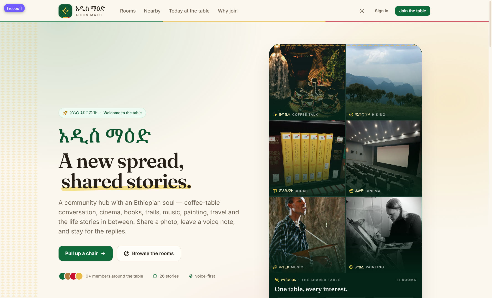
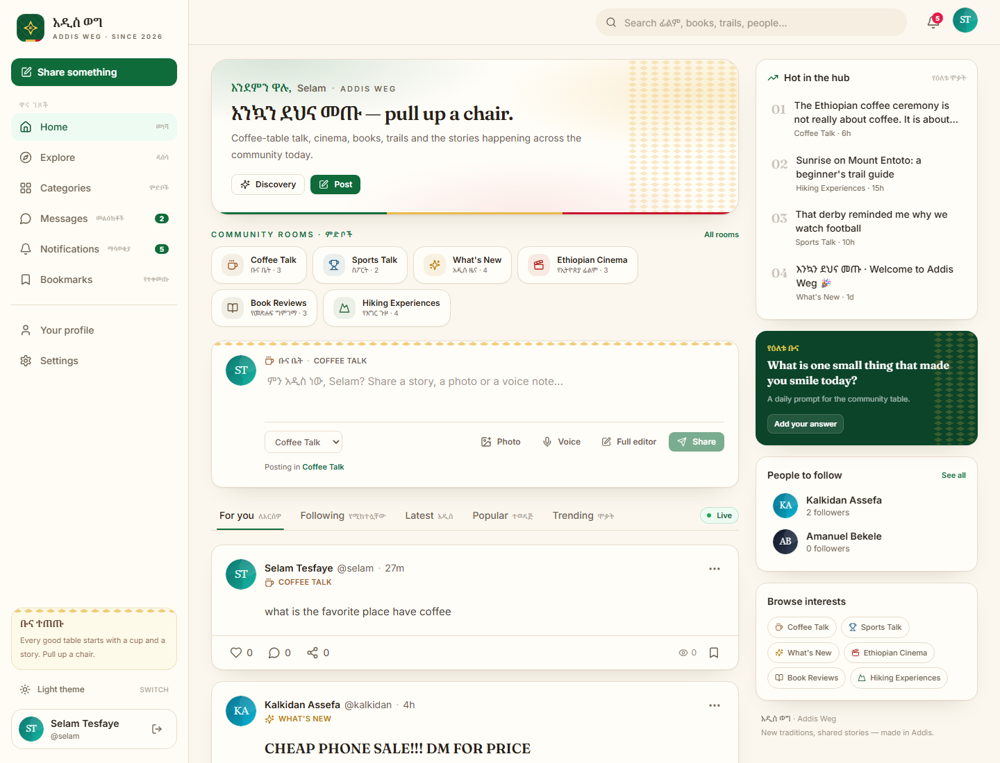
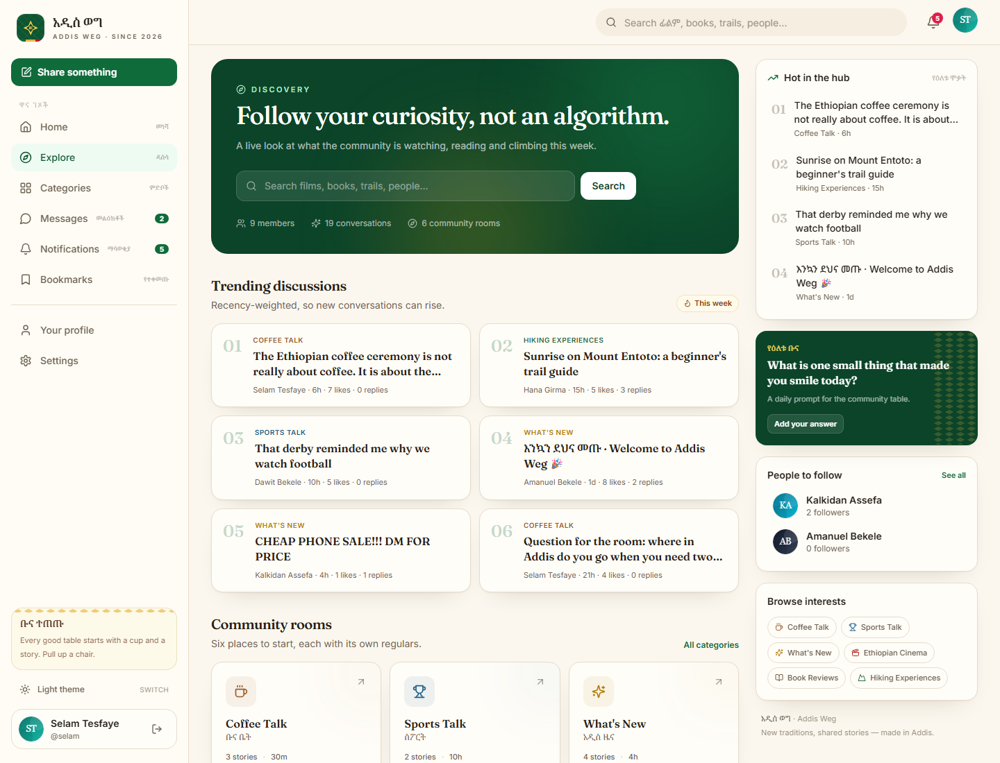
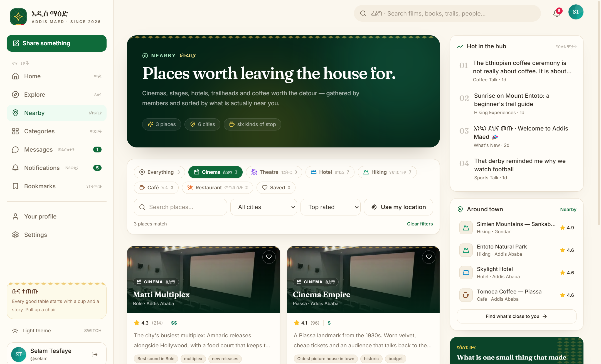
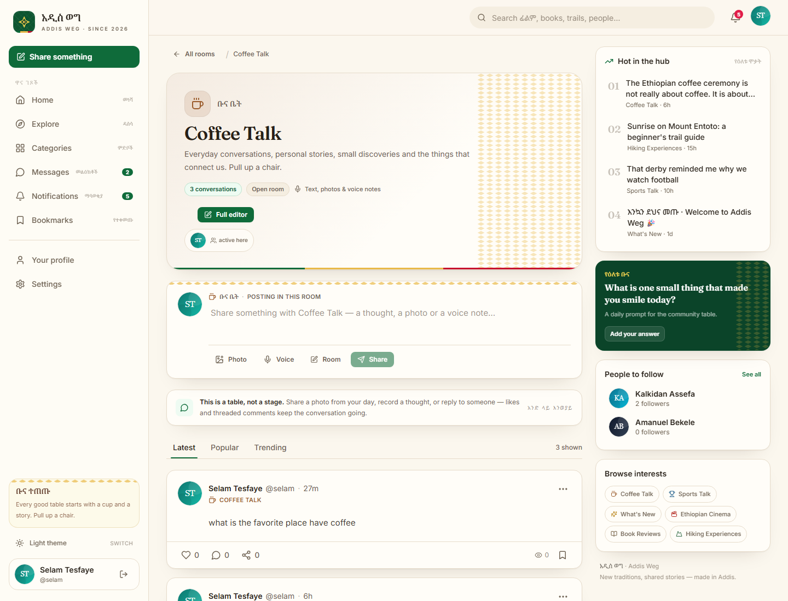
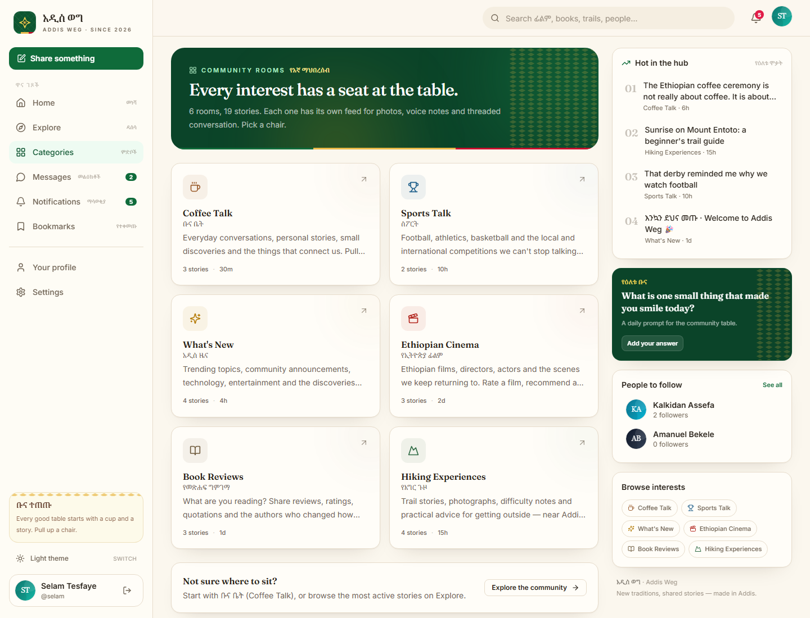
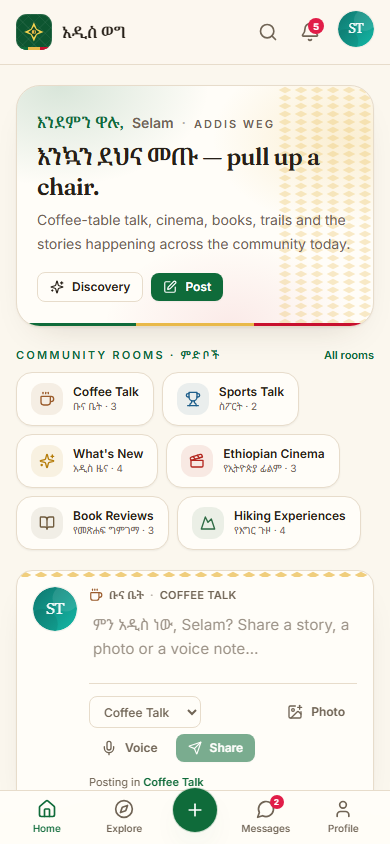

# አዲስ ወግ (Addis Weg)

An Ethiopian community hub for the conversations that don't fit in a group chat: coffee-table talk, sports arguments, Ethiopian cinema, book reviews, trail notes, music, painting, travel and life stories — plus private messaging, notifications, voice notes and a moderation dashboard. The interface is built around a warm parchment palette, highland green and gold, tilet-inspired borders and bilingual Amharic/English labels.

**Stack:** React 18 + TypeScript + Vite + Tailwind CSS · Node.js + Express + Prisma · PostgreSQL + Socket.IO





## What's included

- **Eleven interest rooms** seeded out of the box — Coffee Talk (ቡና ቤት), Sports Talk (ስፖርት), What's New (አዲስ ዜና), Ethiopian Cinema (የኢትዮጵያ ፊልም), Book Reviews (የመጽሐፍ ግምገማ), Hiking Experiences (የእግር ጉዞ), Music (ሙዚቃ), Physical Exercise (የአካል እንቅስቃሴ), Painting (ሥዕል), Travel (ጉዞ) and Life Stories & Experiences (የሕይወት ተሞክሮ). Every room has its own inline composer for text, photos and voice notes, plus likes and threaded comments. Admins can add more categories at runtime.
- **Community feed** with For you / Following / Latest / Popular / Trending sorting, cursor + page pagination, reactions, bookmarks, shares, reporting and inline post composer.
- **Threaded comments** with unlimited replies (flattened to a readable depth), sorting, likes, reply notifications and live counts.
- **Rich post types** for movie reviews (0–10 ratings, posters, trailers), book reviews (0–5 ratings, covers, quotes) and hikes (location, difficulty, distance, duration, tips).
- **Community polls** in any room or as a standalone post: two to six options, one changeable vote per member, and live results broadcast over Socket.IO the moment anyone votes.
- **Ethiopian (Ge'ez) calendar** everywhere dates appear — መስከረም, ጥቅምት, ኅዳር and the rest — shown alongside Gregorian dates and remembered per account from **Settings → Privacy → Calendar**.
- **Real-time direct messages** over Socket.IO: typing indicators, read receipts, message replies, editing/deleting, images, voice notes, in-conversation search and unread counts.
- **Voice messages** recorded in the browser with the MediaRecorder API, uploaded with progress and played back inline; images are validated, resized and thumbnailed with Sharp.
- **Notifications** persisted in PostgreSQL and pushed in real time, with unread badges and deep links.
- **Auth & profiles** with HttpOnly JWT cookies, double-submit CSRF protection, rate limiting, SMS OTP phone verification, SMS password reset, follows, presence privacy, avatars/covers and account deletion.
- **Nearby directory** (`/places`) of 37 cinemas, theatres, hotels, trailheads, cafés, restaurants, gyms, stadiums, galleries and libraries across six Ethiopian cities, each with a detail page, OpenStreetMap pin, directions link, kind photography and a per-device saved shortlist. Browser geolocation sorts the list by real distance, and kind filters are URL-addressable (`/places?kind=HIKING`). Every one of the eleven rooms carries a **Take this room offline** card that surfaces three matching places — cafés for Coffee Talk, cinemas for the film room, stages for Music, gyms for Physical Exercise, stadiums for Sports Talk, galleries for Painting, libraries for Book Reviews, hotels for Travel and shared tables for Life Stories — so an online conversation always has an address.
- **Events** (`/events`) is a sport, cinema and theatre hub: three schedule cards preview the next fixtures, screenings and stage shows, and each opens its full schedule page. The listings themselves are pulled in automatically from online sources — structured sport feeds (Ethiopian Premier League by default, or every major international league with the `international` preset), public Telegram channels used by Addis venues, any RSS/calendar feed, or the AI events desk — normalised and published as event pages with venue, kickoff time, poster and a link back to the organiser. **Meetups** (`/meetups`, its own sidebar entry) are what members host themselves: hikes, watch parties, coffee ceremonies and any other get-together. The page launches a **Schedule a Meetup** form (title, description, start and end time, meeting point, linked room or place, attendee limit and cover art) beside the posted meetup schedule, so members can create and browse in one place; meetups stay separate from imported listings. The importer runs on boot and every `EVENTS_SYNC_MINUTES`, deduplicates by the source's own post id, refreshes rescheduled listings and removes ones the feed no longer publishes. Staff manage feeds in **Admin → Event sources** (add, pause, sync now, delete, plus per-feed last status and error), and every imported event carries its source attribution on the detail page.
- **Sports schedules** (`/sports`) for the leagues people here follow — English Premier League, Spanish La Liga, Italian Serie A and German Bundesliga. The international feed reads ESPN's public scoreboard for whole matchweeks (TheSportsDB's free key only exposes a single next fixture), stores each listing's competition and both club crests, and shows the next three weeks grouped by day and league with kick-off times in the viewer's own timezone. League chips filter the list, every row carries the two club badges and links to the full event page, and the feed records its own sync errors without disturbing the other sources. **Sport, Cinema and Theatre sit as nested categories under Events** in the desktop sidebar and the mobile menu, folded behind a chevron next to the Events link. The group expands automatically when you enter Events or one of its categories and collapses when you leave, and the chevron toggles it by hand at any time. Cinema opens the cinema hub, Theatre opens the events list filtered to theatre, and the parent Events link still shows everything.
- **Cinema hub** (`/cinema`) now opens with **Popular cinemas** — the halls members rate highest, each linking to its venue page — and **Current schedules**, which groups every screening the venue feeds have published by cinema with date, start and end times. Film reviews moved to a second tab on the same page, so schedules and recommendations no longer compete for the top of the screen.
- **Gemini-assisted capture** with a pooled key rotator. Five `GEMINI_API_KEYS` are walked in order for every request: a key that reports its quota as exhausted is parked for as long as Google asks and the next key takes over, so extraction keeps working when one free-tier key runs dry. Gemini reads batches of Telegram posts and turns even the ones the emoji regexes cannot parse (Amharic wording, theatre runs, multi-date cards) into titled, timed, venue-tagged events; the regex parser stays as the fallback when every key is busy. The same pool powers the opt-in AI events desk, which searches for events no feed carries. **Admin → Event sources** shows per-key usage — calls, successes, quota hits, tokens, cooldown and the last error — alongside the pool's model and totals.
- **Search & discovery** across members, posts, movies, books and hikes, plus a recency-weighted trending score and a discovery page.
- **Lets Know Ethiopia** (`/quiz`), a daily Ethiopian culture and history challenge: a 2,000-question curated pool (history, emperors, Adwa, Lalibela, geography, languages, food, music, athletics) served as the same 10 questions for everyone each day, a 150-second timer, instant explanations, and a daily leaderboard ranked by score then completion time.
- **Separate admin workspace** at `/admin` with its own sidebar shell, not a tab buried in the community layout. Nine surfaces: **Overview** (growth, activity trends, engagement, room volume, role mix, top conversations and contributors over 7/30/90-day windows), **Reports** (queue plus reason and target breakdowns and resolution time), **Content** (search and remove posts or comments), **Members** (search by name/email, filter and sort, account drill-down with activity and moderation history, role changes, reasoned suspensions, restores and deletions), **Roles & access** (create custom roles and toggle each role's capabilities), **Audit log** (append-only record of every admin action), **Rooms** (create and edit, including icon and colour), **Announcements** and **Event sources** (the feeds behind the automatic listings).
- **Role-based access control** with a shared permission matrix on both sides of the wire: fourteen named capabilities grouped across insights, moderation, people and platform. Moderators can work reports, remove content and suspend ordinary members; administrators additionally change roles, delete accounts, configure rooms, publish announcements and read the audit trail. Every admin route declares the permission it needs, and the UI hides what the role cannot do. Guard rails stop self-escalation, moderator-on-moderator action, and removing the last administrator.
- **Light/dark themes**, responsive sidebar navigation on desktop (with nested event categories) and bottom navigation plus a category menu on mobile, accessible dialogs and keyboard-friendly controls.





| Coffee Talk room | Categories | Mobile |
| --- | --- | --- |
|  |  |  |

## Repository layout

```
communityhub/
├── frontend/               # React + Vite SPA (all browser code)
│   ├── src/components/     # Layout, feed, media, messaging UI primitives
│   ├── src/pages/          # Public/community pages plus src/pages/admin/ for the staff workspace
│   ├── src/store/          # Zustand auth + UI stores
│   └── nginx.conf          # Production SPA + API proxy
├── backend/                # Express API + Socket.IO gateway (all server code)
│   ├── server.js           # Node entry point — `node backend/server.js`
│   ├── prisma/schema.prisma
│   ├── prisma/migrations/
│   ├── prisma/seed.ts
│   └── src/{routes,lib,middleware,services}/
├── docker-compose.yml
└── .github/workflows/ci.yml
```

## Quick start (Docker)

```bash
cp backend/.env.example backend/.env   # optional for local npm runs
docker compose up --build -d
docker compose exec backend npm run db:seed
```

Open <http://localhost:8080>. The API is available at <http://localhost:8080/api>
(proxied by Nginx), and PostgreSQL is reachable only inside the Compose network.

Set a real `JWT_SECRET` in `.env` before exposing the stack:

```bash
JWT_SECRET=$(node -e "console.log(require('crypto').randomBytes(48).toString('hex'))")
CLIENT_ORIGIN=https://your-domain.example docker compose up -d
```

## Local development (no Docker)

Requirements: Node.js 20+, PostgreSQL 15+.

```bash
npm install

cp backend/.env.example backend/.env
cp frontend/.env.example frontend/.env
# edit DATABASE_URL and set a 32+ character JWT_SECRET

npm run db:migrate     # create the schema
npm run db:seed        # demo members, posts, comments, reviews, messages
npm run dev            # API on :4000, Vite on :5173
```

Open <http://localhost:5173>. Vite proxies `/api`, `/uploads` and `/socket.io` to the API, so authentication cookies stay same-origin.

To run the API as a standalone Node process instead of through the root dev script:

```bash
node backend/server.js            # loads backend/.env; in development it runs src/index.ts through tsx
npm start --workspace backend    # same entry point
```

With `NODE_ENV=production` the entry point runs the compiled `backend/dist/index.js`, which is what the Docker image does.

### Demo accounts

All seeded accounts use `Password123!`.

| Email | Role |
| --- | --- |
| `selam@communityhub.et` | Member |
| `hana@communityhub.et` | Moderator |
| `admin@communityhub.et` | Admin |
| `dawit@communityhub.et`, `meron@communityhub.et`, `abel@communityhub.et`, `sara@communityhub.et`, `yonas@communityhub.et`, `kalkidan@communityhub.et` | Members |

The sign-in page has a **Use demo** button that fills Selam's credentials.

## Environment variables

### API (`backend/.env`)

| Variable | Default | Notes |
| --- | --- | --- |
| `DATABASE_URL` | — | PostgreSQL connection string |
| `JWT_SECRET` | — | 32+ characters; generate a random 96-char hex string |
| `JWT_EXPIRES_IN_DAYS` | `7` | Session lifetime |
| `PORT` | `4000` | API port |
| `CLIENT_ORIGIN` | `http://localhost:5173` | Primary allowed origin |
| `CORS_EXTRA_ORIGINS` | empty | Comma-separated additional origins |
| `PUBLIC_API_URL` | empty | Absolute media base URL; relative URLs when empty |
| `UPLOAD_DIR` | `./uploads` | Local media directory |
| `MAX_UPLOAD_MB` | `25` | Per-file upload limit |
| `SMS_PROVIDER` | `console` | `console`, `twilio` or `knock` |
| `SMS_FROM` | `CommunityHub` | Sender label |
| `TWILIO_ACCOUNT_SID` / `TWILIO_AUTH_TOKEN` / `TWILIO_FROM` | empty | Required for `twilio` |
| `KNOCK_API_KEY` / `KNOCK_SMS_WORKFLOW` | empty / `phone-verification` | Required for `knock` |

With `SMS_PROVIDER=console` (development only), verification and reset codes are logged and returned in the API response as `devCode`, and the settings screen displays them. Production requires a real provider.

### Web (`frontend/.env`)

| Variable | Default | Notes |
| --- | --- | --- |
| `VITE_API_URL` | empty | Leave empty with the Vite proxy or Nginx; set to the API origin only when hosting separately |

## Scripts

| Command | Purpose |
| --- | --- |
| `npm run dev` | Run API + Vite together |
| `node backend/server.js` | Start only the API with Node (TS source in development, `dist/` in production) |
| `npm run build` | Build API (`tsc`) and web (`vite build`) |
| `npm run typecheck` | Typecheck both workspaces |
| `npm run db:migrate` | Create/apply a development migration |
| `npm run db:deploy` | Apply committed migrations (production/CI) |
| `npm run db:seed` | Load the demo community |
| `npm run db:reset` | Drop, migrate and reseed (destructive) |

## Architecture notes

- **Authentication** uses a signed JWT in an HttpOnly `ch_token` cookie plus a readable `ch_csrf` cookie echoed in `x-csrf-token` for every mutation. Tokens are invalidated by `passwordChangedAt` after password changes and resets. Helmet, CORS allow-listing, per-route rate limits and Zod validation are applied globally.
- **Authorization** is enforced server-side on every post, comment, media, message and admin route — conversation participants are checked on both REST and Socket.IO paths.
- **RBAC:** `backend/src/lib/rbac.ts` owns the permission catalogue and role map, and `requirePermission` guards each admin route. `frontend/src/lib/rbac.ts` mirrors it for rendering. The dashboard reads the caller's live permission list from `GET /api/admin/me`, so nav items and action menus disappear for roles that lack them; the API still rejects anything attempted directly. Consequential actions write to the `AdminAction` audit table with the actor, role, target and reason.
- **Realtime:** connecting clients join `user:<id>` rooms. Message send/edit/delete/read, typing and presence events are authorized in `backend/src/socket.ts`; notification and feed counters are persisted before broadcast, so reconnecting clients resync from REST.
- **Polls** are a `Poll` row with ordered `PollOption` children and one `PollVote` per member. Option counts are denormalised inside the same transaction as the vote, then broadcast as `poll:update` so every open feed moves together; changing a vote moves the count between options rather than adding another.
- **Ethiopian dates** are derived on the client from Julian Day Numbers (`frontend/src/lib/ethiopian.ts`), so no stored timestamp changes when a member flips the calendar. The preference is stored on `User.calendarPreference` and cached in the UI store for instant rendering.
- **Media** is stored on disk by default (`backend/uploads`) with URLs, thumbnails, dimensions, ownership and post/message links in PostgreSQL. `backend/src/lib/storage.ts` is a single adapter — swap it for S3/R2 without touching the routes. Serve uploads from Nginx or a CDN in production.
- **Trending** is a recency-weighted score (`likes + 2 × comments + 3 × bookmarks`, divided by an age decay), not an all-time like count.
- **Categories** are rows, not enums: admins create rooms from the dashboard, choose an icon and colour, and the category page, composer and filters pick them up automatically.

## Deployment (Ubuntu VPS, Docker CI/CD)

Every push to `main` runs `.github/workflows/deploy.yml`: it builds both images and publishes
`ghcr.io/abmak/communityhubaddisweg/api` and `…/web`, tagged with the commit and as `latest`.
`.github/workflows/ci.yml` still migrates a disposable PostgreSQL, seeds, typechecks and builds on
every push and pull request.

The roll-out is pull-based. GitHub's runners cannot open SSH to this server, so the server watches
`main` itself: `deploy/update.sh` runs from cron every two minutes, copies
`deploy/docker-compose.prod.yml` from the repository, pulls the `:latest` images and recreates only
the containers whose image changed. A push is live about two minutes after its build finishes, and
the pipeline needs no credentials to the machine. The GHCR packages are public, so the server pulls
them anonymously.

### One-time VPS setup

1. Install Docker Engine + Compose v2 and open port 8080 (plus 80/443 once a domain is set).
2. Create the deploy directory and put the deploy files in it:
   ```sh
   mkdir -p ~/communityhub && cd ~/communityhub
   # copy deploy/docker-compose.prod.yml, deploy/.env.example, deploy/Caddyfile and deploy/update.sh here
   sh deploy.sh          # writes .env, generates POSTGRES_PASSWORD, DATABASE_URL and JWT_SECRET
   ```
3. Install the puller for the current user:
   ```sh
   (crontab -l 2>/dev/null; echo "*/2 * * * * $HOME/communityhub/update.sh >> $HOME/communityhub/update.log 2>&1") | crontab -
   ```
4. Seed the demo community once:
   `docker compose -f docker-compose.prod.yml exec backend npm run db:seed`

Without `DOMAIN` in `.env` the web container publishes on port 8080, `update.sh` binds it to
`0.0.0.0` and sets `COOKIE_SECURE=false` — over plain HTTP a browser discards Secure cookies, so
without that the session never sticks and every like or comment answers "Authentication required".
The cookie is therefore unencrypted in transit, which is fine for a trial host and not for real
members: once DNS points at the server set `DOMAIN=addisweg.et` (or your host) in `.env`, set
`COOKIE_SECURE=true` and the next roll-out starts Caddy, which takes over ports 80/443, fetches the
certificate automatically, proxies websocket upgrades, and the web port falls back to loopback.

Run the build by hand from **Actions → Deploy → Run workflow**; the server picks the new images up
on its next tick. `.env` lives only on the server and is never overwritten. Migrations run when the
API container starts. `deploy/deploy.sh` and the `VPS_*` repository secrets are only needed for a
push-based roll-out from CI over SSH; this host does not accept SSH from GitHub's runners.

### Manual fallback

`docker compose up -d --build` still works from a clone for a from-source deployment, followed by
`docker compose exec backend npm run db:seed` once. Back up the `postgres-data` and `uploads`
volumes; for multi-instance deployments move media to object storage and run migrations as a
release step instead of on container start.

## Verification performed

- `npm run typecheck` and `npm run build` pass for both workspaces.
- Migrations and seed run cleanly against PostgreSQL 18 locally.
- API smoke tests covered register, login, SMS OTP verification, password reset, follow, feed sorting, likes, bookmarks, threaded comments, notifications, conversations, messaging, search and admin analytics.
- Admin/RBAC verification: moderator and administrator sessions were exercised against the live API — role changes, suspensions without a reason, acting on an administrator, account deletion and audit access are all rejected for moderators with the expected 403s; a suspension blocks the member's next sign-in; restores work; and each role change, suspension and restore appears in the audit trail.
- Browser E2E: sign-in with the demo account, feed and sorting, post detail with comments, explore, cinema, admin dashboard, conversation load and realtime send, mobile layout at 390 px, dark theme, plus image upload → thumbnail → post attachment → render → delete cleanup.
- Poll verification: created from the room composer, rejected a one-option poll, voted from three accounts, confirmed repeat votes are idempotent, moving a vote shifts both counts, anonymous viewers see totals but no choice, and a connected Socket.IO client received `poll:update` for another member's vote.
- Event import verification: the seeded Premier League, international-league and Century Cinema sources synced against their live feeds, publishing fixtures and a screening with the right venue, local kickoff time and source link; a bad feed recorded an error on its own row without affecting the other sources; creating, syncing and deleting a source from **Admin → Event sources** round-tripped through the UI; a member-created meetup posted as `MEETUP` while imported listings stayed `EVENT`, and both tabs filtered correctly.
- Sports & cinema verification: the international feed imported 293 ESPN fixtures in one sync, and `/api/events/sports` returned 30 Premier League, 30 La Liga, 40 Serie A and 27 Bundesliga matches inside the 21-day window. `/sports` rendered all 127 with GMT+3 kick-off times and both club crests per fixture, the La Liga chip filtered to its 30, and a fixture opened its event page. `/api/events/cinemas` returned six popular halls with the curated venues first and grouped the Century Cinema screening; the Cinema page showed both sections, and the Film reviews tab still loaded its posts. The sidebar nested Sport, Cinema and Theatre under Events on desktop and in the mobile menu; `/theatre` opened the events list with the Theatre filter active. No console errors were observed on any of these pages.
- Gemini verification: all five keys answered a model listing; a Telegram batch was extracted into clean rows ("Halloween Scream 1996 Screening" at Century Cinema, topic CINEMA, `aiExtracted` set) with the token count recorded; quota exhaustion was observed key by key, rotated around, parked with Google's own retry delay and persisted per model so a restart spends nothing on a capped key; when the primary model's daily cap ran out on every key the pool switched to the lighter fallback and kept extracting for one request per sync; the per-key panel rendered calls, successes, quota hits, tokens, cooldown state and the last error; with both models parked a sync fell back to regex and the AI desk reported a readable error while the other sources kept importing.
- Calendar verification: the Settings toggle round-tripped `calendarPreference` through `PATCH /api/users/me` and `/api/auth/me`, and the UI rendered `ጥቅምት 13, 2019 · 23 Oct 2026` on the settings preview, feed and event dates.
- Deployment verification: the Deploy workflow built and published both images for the release commit, the cron puller on the VPS moved the stack from the previous pinned tag to the new `:latest` digest within a tick, `docker compose exec backend npm run db:seed` populated the production database, `/api/categories` returned the seeded rooms and the SPA answered 200 over `http://196.189.155.179:8080`.

## Image credits

The landing hero is a mosaic of the interests the hub brings together. All tiles come from Wikimedia Commons, cropped square and re-encoded to 640 px WebP in `frontend/src/assets/rooms/`:

| Tile | File | Author | Licence |
| --- | --- | --- | --- |
| Coffee Talk | [Coffee ceremony of Ethiopia and Eritrea 4](https://commons.wikimedia.org/wiki/File:Coffee_ceremony_of_Ethiopia_and_Eritrea_4.jpg) | ProtoplasmaKid | [CC BY-SA 4.0](https://creativecommons.org/licenses/by-sa/4.0/) |
| Hiking | [Simien Mountains Landscape, Ethiopia](https://commons.wikimedia.org/wiki/File:Simien_Mountains_Landscape,_Ethiopia_(2466923746).jpg) | A. Davey | [CC BY 2.0](https://creativecommons.org/licenses/by/2.0/) |
| Books | [African biography reference books, Library of Congress](https://commons.wikimedia.org/wiki/File:African_biography_reference_books_-_Main_Reading_Room_-_Library_of_Congress.jpg) | Djembayz | [CC BY-SA 3.0](https://creativecommons.org/licenses/by-sa/3.0/) |
| Cinema | [Piccadilly Cinema screen, Perth](https://commons.wikimedia.org/wiki/File:Piccadilly_Cinema_screen,_Perth.jpg) | Rob Chandler | [CC BY 2.0](https://creativecommons.org/licenses/by/2.0/) |
| Music | [Krar player, ethiopia](https://commons.wikimedia.org/wiki/File:Krar_player,_ethiopia.jpg) | Steve Evans | [CC BY 2.0](https://creativecommons.org/licenses/by/2.0/) |
| Painting | [Chris OMoore painting at easel 2023](https://commons.wikimedia.org/wiki/File:Chris_OMoore_painting_at_easel_2023.jpg) | Comoore | [CC BY 4.0](https://creativecommons.org/licenses/by/4.0/) |
| Sports | [ET Addis asv2018-01 img02 Stadium](https://commons.wikimedia.org/wiki/File:ET_Addis_asv2018-01_img02_Stadium.jpg) | A. Savin | [Free Art License](https://fr.wikipedia.org/wiki/Licence_art_libre) |
| What's New | [Newspapers in Yaoundé, Cameroon - 2020 (cropped)](https://commons.wikimedia.org/wiki/File:Newspapers_in_Yaound%C3%A9,_Cameroon_-_2020_(cropped).jpg) | VOA / Emmanuel Jules Ntap | Public domain |
| Physical Exercise | [Womens in Great Run - Ethiopia](https://commons.wikimedia.org/wiki/File:Womens_in_Great_Run_-_Ethiopia.jpg) | Teddy setegn | [CC BY-SA 4.0](https://creativecommons.org/licenses/by-sa/4.0/) |
| Travel | [Blue Boat, Lake Tana (8958188650)](https://commons.wikimedia.org/wiki/File:Blue_Boat,_Lake_Tana_(8958188650).jpg) | Rod Waddington | [CC BY-SA 2.0](https://creativecommons.org/licenses/by-sa/2.0/) |

Swap any tile by replacing the matching file in that folder — the grid, labels and credits are the only places that reference it.

The Nearby directory adds five more photographs in `frontend/src/assets/places/`. Cinema, hiking, café and stadium cards reuse the tiles above; the rest are:

| Place kind | File | Author | Licence |
| --- | --- | --- | --- |
| Theatre | [War Horse (8570054457)](https://commons.wikimedia.org/wiki/File:War_Horse_(8570054457).jpg) | Eva Rinaldi | [CC BY-SA 2.0](https://creativecommons.org/licenses/by-sa/2.0/) |
| Hotel | [Ethiopian Skylight Hotel](https://commons.wikimedia.org/wiki/File:Ethiopian_Skylight_Hotel.jpg) | Prime Minister of Ethiopia Office | Public domain |
| Restaurant | [Veggie combo at Fassil Restaurant](https://commons.wikimedia.org/wiki/File:Veggie_combo_at_Fassil_Restaurant.jpg) | StoppedTime | [CC0](https://creativecommons.org/publicdomain/zero/1.0/) |
| Gym | [Multifunctional cable and row machines in a gym](https://commons.wikimedia.org/wiki/File:Multifunctional_cable_and_row_machines_in_a_gym.jpg) | San Francisco Foghorn | [CC BY 2.0](https://creativecommons.org/licenses/by/2.0/) |
| Gallery | [Art gallery guided tour visitors viewing colorful painting](https://commons.wikimedia.org/wiki/File:Art_gallery_guided_tour_visitors_viewing_colorful_painting.jpg) | Ristever | [CC0](https://creativecommons.org/publicdomain/zero/1.0/) |

Library cards reuse the Books tile, and every room page carries its own room photograph, so all eleven rooms and all ten place kinds are covered by the credited set above.

## Known limitations

- Media uses local disk storage; use object storage for horizontal scaling.
- Email verification is not implemented; accounts are identified by email but recoverable by SMS.
- Voice recording requires a secure context (HTTPS or localhost) and a browser with `MediaRecorder`; the UI explains when neither is available.
- Rate limiting is in-memory, so it should move to Redis when running more than one API instance.
